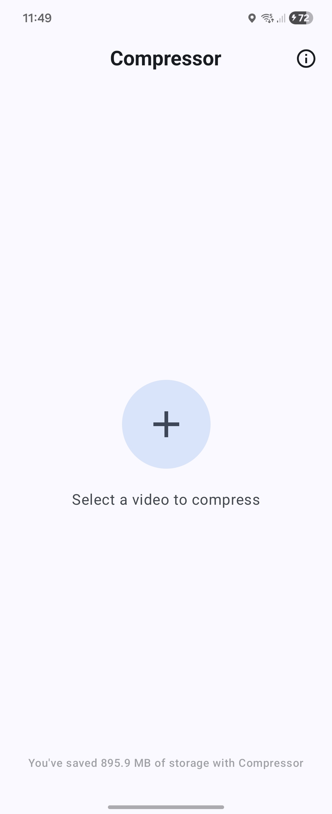
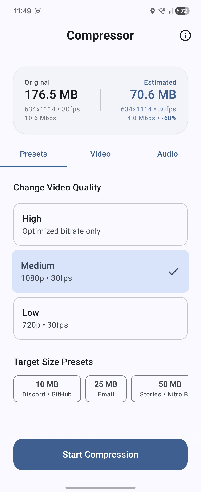
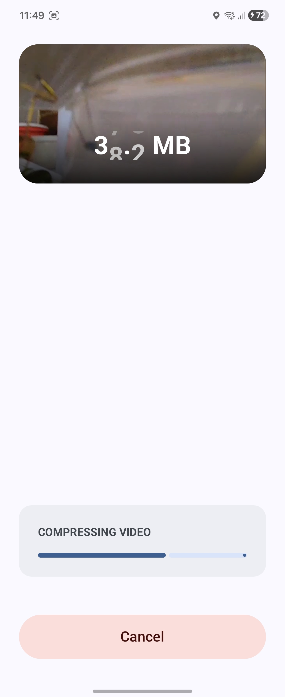
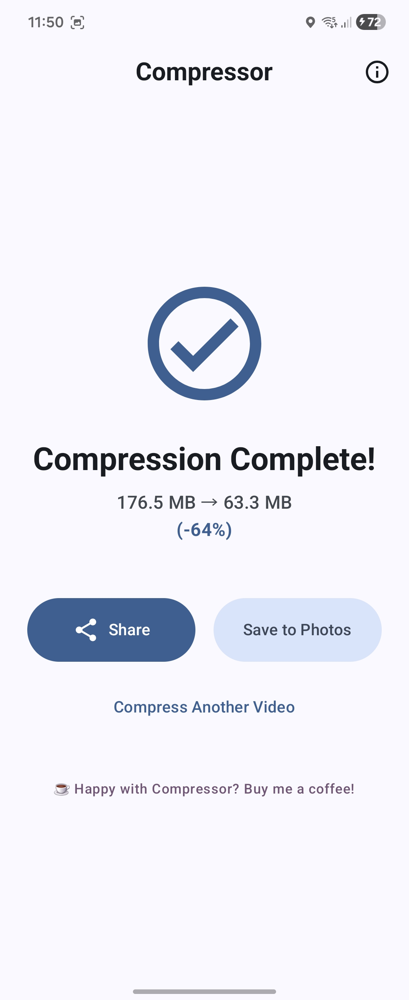

  

# Galaxy Compressor

On-device Android batch video compression with sampled quality checks, original-file recovery and separate profiles for the Galaxy S26 Ultra and S23 Ultra.

[Download v1.6.335 (APK)](https://github.com/Zfkirke0109/Compressor/releases/download/ci-1.6.335/Galaxy-Compressor-v1.6.335-ci-arm64.apk) · [All releases](https://github.com/Zfkirke0109/Compressor/releases) · [Changelog](CHANGELOG.md) · [Android CI](https://github.com/Zfkirke0109/Compressor/actions/workflows/android-ci.yml?query=branch%3Amain)

   

<em>Original Compressor screenshots</em>

## Install

Galaxy Compressor runs on 64-bit ARM devices with Android 7.0 or later. The current GitHub pre-release contains a debug APK signed with this fork’s stable CI certificate. It installs fresh and can update an existing PR #44 or Android CI build in place, preserving settings and learned profiles. The package is `io.github.zfkirke0109.galaxycompressor`. Android requires a matching signing certificate for an in-place update.

## Compressing a batch

1. Select videos in the app, or share them to Galaxy Compressor from the gallery. Use copy mode to keep the originals while evaluating the results.
2. Choose **Perceptually Lossless** to search for a smaller encode. The app checks the final video against the source timeline, audio and color information, then measures aligned decoded frames in sampled windows. It keeps the original when a candidate is too large, misses a quality check or cannot be verified. **Remux only** copies compatible tracks without re-encoding.
3. Read each result to see whether the original was kept, a copy was saved, or a replacement was verified or needs recovery. Batch-wide suggestions explain their effect before you apply them. A log-only export is available in Downloads.

You can adjust codec, frame rate and thermal pacing, and choose whether to preserve recording dates and location. Optional Shizuku support provides another route for authorized file operations.

## What changed in v1.6.335

The S26 Ultra and S23 Ultra use separate encoder profiles. Exhaustive mode can try a lower measured bitrate, use a bounded hardware AVC search on eligible inputs and retry a safer measured bitrate when needed. Device-specific learning, native frame preparation and targeted MP4/AAC repairs support that search. Gallery saves now require a successful publish and a byte-for-byte read-back before Compressor reports success. [Release notes](CHANGELOG.md) · [Quality criteria](docs/PERCEPTUALLY_LOSSLESS.md) · [Device validation](docs/DEVICE_VALIDATION.md)

## About this fork

Galaxy Compressor builds on JoshAtticus’s Compressor and its Kotlin and Android Media3 implementation. This fork adds batch workflows, hardware encoder controls, metadata preservation, recovery for interrupted replacements, and per-video verification. The store listings and historical benchmarks below belong to the original project. [Upstream repository](https://github.com/JoshAtticus/Compressor) · [Privacy and local data](PRIVACY.md)

## Original App Stats & Downloads

These downloads and statistics are for JoshAtticus’s upstream package, `compress.joshattic.us`.

   

  

---

Do you like the original Compressor? Consider supporting JoshAtticus by [buying a coffee](https://www.buymeacoffee.com/joshatticus) ☕️

You can also donate with crypto:
- **Bitcoin:** `bc1q8hkcv5xejcg4n4vf5839pqytp87v92rtgyyccr`
- **Ethereum:** `0xC5Ae73a73F83CF48ed1Cb832ccb9Ca5ff1776EC9`
- **Litecoin:** `ltc1qmf9s65cwk65rlepjme4auqhw7t2wz98f00n3t4`
- **Solana Mainnet:** `HSkCeCd8BzabeVJTzrqcFYvsRmSGLrrDdtZ61oYBgNoD`

---

## Historical upstream benchmarks

JoshAtticus recorded these benchmarks with the upstream Google Play release, version 1.5.2. The baseline videos and original measurements are reproduced below. Galaxy Compressor’s S26 measurements are in the [device validation notes](docs/DEVICE_VALIDATION.md).

<b>Testing Devices</b>

 
The following devices are used for testing where possible:

| Device                      | SoC                     | RAM  |
|-----------------------------|-------------------------|------|
| **Google Pixel 8 Pro** | Tensor G3               | 12GB |
| **Samsung Galaxy S21+** | Exynos 2100             | 8GB  |
| **Samsung Galaxy S10** | Exynos 9820             | 8GB  |
| **Samsung Galaxy S9** | Exynos 9810             | 4GB  |
| **Samsung Galaxy S7** | Exynos 8890             | 4GB  |
| **Samsung Galaxy A71 4G** | Snapdragon 730          | 6GB  |
| **Samsung Galaxy A32 4G** | Helio G80               | 6GB  |
| **Samsung Galaxy A05s** | Snapdragon 680          | 4GB  |

<b>4K60 HEVC SDR - Walk in the Park</b>

 
<b>197.3MB 4K 60fps HEVC SDR video compressed using the Medium preset in Compressor.</b>

| Device                      | Speed    | Final Size      |
|-----------------------------|----------|-----------------|
| **Google Pixel 8 Pro** | 13s 42ms | 70.1MB (-64%)   |
| **Samsung Galaxy S21+ (Exynos)**| 16s 50ms | 76.8MB (-61%)   |
| **Samsung Galaxy S10 (Exynos)** | 21s 24ms | 78.0MB (-60%)   |
| **Samsung Galaxy S9 (Exynos)** | 35s 77ms | 77.7MB (-60%)   | 
| **Samsung Galaxy S7 (Exynos)** | 43s 48ms | 77.6MB (-60%)   |
| **Samsung Galaxy A71 4G** | 64s 19ms | 77.4MB (-60%)   |

The following testing devices were ineligible for this benchmark:
| Device                      | Reason                                    |
|-----------------------------|-------------------------------------------|
| **Samsung Galaxy A32 4G** | Hardware cannot handle this video         |
| **Samsung Galaxy A05s** | Hardware cannot handle this video         |

<b>4K30 HEVC HDR10+ - Challenging Lighting</b>

 
<b>136.8MB 4K 30fps HEVC HDR10+ video compressed using the Medium preset in Compressor.</b>

| Device                      | Speed    | Final Size      |
|-----------------------------|----------|-----------------|
| **Google Pixel 8 Pro** | 7s 23ms  | 51.5MB (-60%)   |
| **Samsung Galaxy S21+ (Exynos)**| 9s 27ms  | 50.6MB (-61%)   |
| **Samsung Galaxy S10 (Exynos)** | 12s 03ms | 51.2MB (-60%)   |
| **Samsung Galaxy S9 (Exynos)** | 16s 59ms | 51.7MB (-60%)   | 
| **Samsung Galaxy A71 4G** | 22s 84ms | 50.7MB (-61%)   |

The following testing devices were ineligible for this benchmark:
| Device                      | Reason                                    |
|-----------------------------|-------------------------------------------|
| **Samsung Galaxy S7 (Exynos)** | Hardware cannot handle HDR10+             |
| **Samsung Galaxy A32 4G** | Hardware cannot handle this video         |
| **Samsung Galaxy A05s** | Hardware cannot handle this video         |

<b>8K24 HEVC SDR - Ultra High Resolution</b>

 
<b>266.4MB 8K 24fps HEVC SDR video compressed using the Medium preset in Compressor.</b>

| Device                      | Speed    | Final Size      |
|-----------------------------|----------|-----------------|
| **Google Pixel 8 Pro** | 16s 21ms | 99.5MB (-60%)   |
| **Samsung Galaxy S21+ (Exynos)**| 68s 27ms*| 98.9MB (-61%)   |
| **Samsung Galaxy S10 (Exynos)** | 38s 07ms | 100.3MB (-60%)  |

*I'm unsure what happened here, but the S21+ lags significantly when even just playing the original 8K video in the Gallery app and is only able to do 8K playback at 15fps. Perhaps Samsung's Exynos 2100 SoC has a regression in 8K decoding performance? This is an extremely strange result, but it happened across three retries and even when an active cooling source was applied.

The following testing devices were ineligible for this benchmark:
| Device                      | Reason                                    |
|-----------------------------|-------------------------------------------|
| **Samsung Galaxy S9 (Exynos)** | Hardware cannot handle this video         |
| **Samsung Galaxy S7 (Exynos)** | Hardware cannot handle this video         |
| **Samsung Galaxy A71 4G** | Hardware cannot handle this video         |
| **Samsung Galaxy A32 4G** | Hardware cannot handle this video         |
| **Samsung Galaxy A05s** | Hardware cannot handle this video         |

<b>1080p60 HEVC SDR - Consistent Subject</b>

 
<b>34.5MB 1080p 60fps HEVC SDR video compressed using the Medium preset in Compressor.</b>

| Device                      | Speed    | Final Size      |
|-----------------------------|----------|-----------------|
| **Google Pixel 8 Pro** | 3s 45ms  | 12.7MB (-61%)   |
| **Samsung Galaxy S21+ (Exynos)**| 4s 73ms  | 98.9MB (-61%)   |
| **Samsung Galaxy S10 (Exynos)** | 5s 38ms  | 12.9MB (-60%)   |
| **Samsung Galaxy S9 (Exynos)** | 9s 05ms  | 13.0MB (-60%)   |
| **Samsung Galaxy S7 (Exynos)** | 17s 02ms | 12.8MB (-61%)   |
| **Samsung Galaxy A71 4G** | 9s 92ms  | 12.8MB (-61%)   |
| **Samsung Galaxy A32 4G** | 11s 41ms | 13.1MB (-60%)   |
| **Samsung Galaxy A05s** | 22s 27ms | 12.8MB (-61%)   |

<b>Old Benchmarks</b>

 
How does Compressor run on different devices? All tests are completed with a 25 second, 200MB 4K video compressed using the Medium preset in Compressor.

| Device                      | Speed    |
|-----------------------------|----------|
| **Google Pixel 8 Pro** | 11s 61ms |
| **Samsung Galaxy S25** | 7s 99ms  |
| **Samsung Galaxy S10 (Exynos)** | 11s 27ms |
| **Samsung Galaxy S8+ (Exynos)** | 20s 79ms |
| **Samsung Galaxy S7 (Exynos)** | 25s 35ms |

And what about Compressor vs Panda Video Compressor, a highly rated video compression app filled with ads with 10M+ downloads. These tests were done using each app on their respective medium presets.

| Device                      | Compressor | Panda Video Compressor |
|-----------------------------|------------|------------------------|
| **Google Pixel 8 Pro** | 11s 61ms   |  21m 40s 49ms          |

I ran out of time waiting for my 21 minute video compression so I only ran it on my main phone, my Pixel 8 Pro. Hopefully this gives you an idea of how much faster Compressor is compared to an outdated ffmpeg wrapper using software encoding. To be precise, it's 117x faster.

<b>Download Baseline Videos</b>

 
If you would like to test Compressor on your own device, you can download the baseline videos used in the benchmarks below. The baseline videos are not for commercial use. Compressor Baseline Videos © 2026 by JoshAtticus is licensed under CC BY-NC-ND 4.0.

You can download them [here](https://l.joshattic.us/mDAc6J)

 

*Why are the new benchmarks worse than the old ones?* Glad you asked! The old "benchmark" video was already quite low bitrate. It was simply a video of me violently shaking my phone around for 25 seconds. The new baseline videos are much more complex and contain more detail, creating a much more accurate benchmark for real world use.

*Why have some devices been removed?* I removed the Galaxy S8+ because it was running a custom ROM which may have unfairly affected its score. The Galaxy S25 was removed as I do not have access to it anymore (I got a friend to do the testing for me, and I don't want to bother them to retest). **The Galaxy S21+ will not be included in future tests as it is now broken and I can no longer test on it.**

*Why are there new devices added?* I added the Galaxy S9 and ~~S21+~~ to get a more complete picture of how Compressor performs on older flagships. The Galaxy A71, A32 and A05s were added to see how Compressor performs on older midrange devices and newer budget devices. All three of these categories make up a significant amount of my Play Store users, so I wanted to make sure Compressor performs well on them.

---

## Upstream credits

Compressor wouldn't be possible without these amazing people

[@rA9stuff](https://github.com/rA9stuff) - Inspiration to create Compressor & donated

[@tgranz](https://github.com/tgranz) - Provided funding to get Compressor on Google Play

[@sirtoaks](https://github.com/sirtoaks) - Provided funding to get Compressor on Google Play

[@AhmedRX20](https://github.com/AhmedRX20) - Translated into Arabic

I would like to acknowledge that Compressor has used AI language models to assist in translation. Should you find any issues in translation, please open a bug report or a pull request so they can be fixed.

---

## Upstream star history

